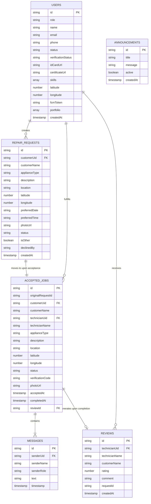
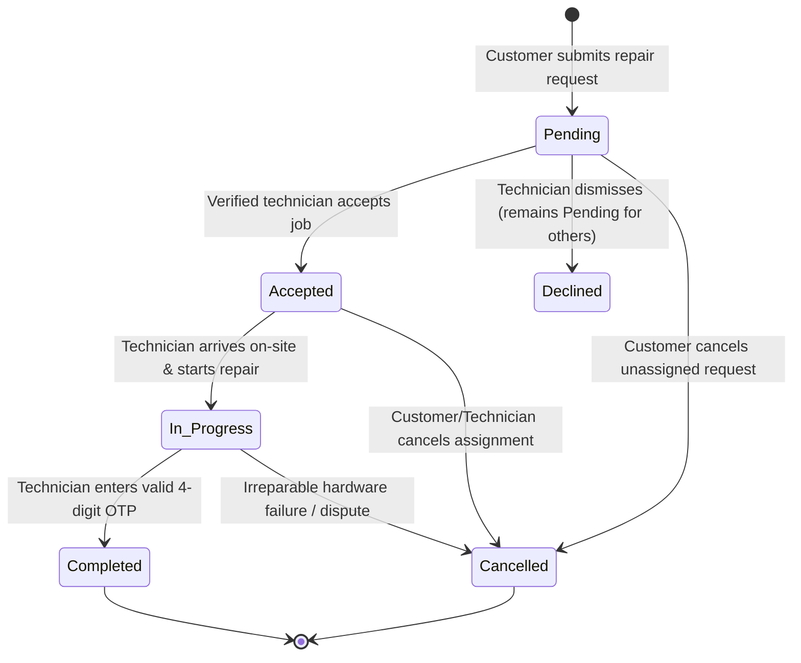

# Data Schema Specification — FixLink Mobile
**Cebu Roosevelt Memorial Colleges — College of Computer Studies**  
*Bachelor of Science in Information Technology (BSIT) — Capstone 2026*  
**Database Engine:** Google Cloud Firestore (NoSQL Document Store)  

---

## 1. Schema Overview & Entity Relationship

FixLink structures its data model around a state-partitioned design. Instead of keeping all requests in a single bloated collection, active dispatch utilizes two primary collections:
1. `repairRequests`: High-velocity pool of pending, unassigned jobs scanned by the skill-matching engine.
2. `acceptedJobs`: Isolated collection for active and completed service workflows with nested subcollections for chat messages.

---

## 2. Detailed Firestore Collection Specifications

### 2.1 `users` Collection
Stores credential, profile, verification, and live location data for both Customers and Technicians.

| Field | Data Type | Requirement | Description / Valid Values |
|---|---|---|---|
| `id` | `string` | **Required** | Primary Key; corresponds directly to Firebase Authentication UID. |
| `name` | `string` | **Required** | User's full legal name. |
| `email` | `string` | **Required** | Unique email address used for login and notifications. |
| `phone` | `string` | Optional | Contact mobile number for coordination calls. |
| `role` | `string` | **Required** | `'customer'` or `'technician'`. |
| `status` | `string` | Optional | `'active'`, `'pending_verification'`, or `'suspended'`. (Defaults to `'active'` for customers). |
| `verificationStatus`| `string` | Optional | Technician credential state: `'unverified'`, `'pending'`, `'verified'`. |
| `idCardUrl` | `string` | Technicians | URL or local path to uploaded Government-issued identification card. |
| `certificateUrl` | `string` | Technicians | URL or local path to uploaded TESDA/Vocational competency certificate. |
| `skills` | `array<string>`| Technicians | Registered skill badges: `['Refrigerator', 'Washing Machine', 'Computer', 'Laptop', 'General Repair', 'Others']`. |
| `latitude` | `number` | Optional | Last reported latitude coordinate from mobile device GPS. |
| `longitude` | `number` | Optional | Last reported longitude coordinate from mobile device GPS. |
| `locationUpdatedAt` | `string` | Optional | ISO-8601 timestamp of the most recent GPS coordinate ping. |
| `fcmToken` | `string` | Optional | Firebase Cloud Messaging device registration token for push notifications. |
| `portfolio` | `array<object>`| Technicians | Proof-of-work repairs: `[{ title, description, imageUrl, completedAt }]`. |
| `rating` | `number` | Optional | Average aggregated rating (1.0 to 5.0). |
| `totalReviews` | `number` | Optional | Total count of submitted reviews. |
| `createdAt` | `string` | **Required** | ISO-8601 timestamp of account creation. |

---

### 2.2 `repairRequests` Collection
Represents unassigned, pending service requests awaiting technician acceptance.

| Field | Data Type | Requirement | Description / Valid Values |
|---|---|---|---|
| `id` | `string` | **Required** | Firestore auto-generated document ID. |
| `customerUid` | `string` | Optional | Reference to `users.id` of the requesting customer. |
| `customerName` | `string` | **Required** | Customer display name for the job ticket. |
| `applianceType` | `string` | **Required** | Category of appliance: `'Refrigerator'`, `'Washing Machine'`, `'Desktop Computer'`, `'Laptop'`, `'Television'`, `'Others'`. |
| `description` | `string` | **Required** | Customer's description of the appliance failure symptoms. |
| `location` | `string` | **Required** | Formatted street address or community landmark. |
| `latitude` | `number` | Optional | Geocoded latitude coordinate of the customer's service location. |
| `longitude` | `number` | Optional | Geocoded longitude coordinate of the customer's service location. |
| `preferredDate` | `string` | Optional | Customer requested service date (`YYYY-MM-DD`). |
| `preferredTime` | `string` | Optional | Preferred appointment time slot (e.g., `'Morning (8AM-12PM)'`). |
| `photoUrl` | `string` | Optional | Public URL of the uploaded image of the broken device. |
| `status` | `string` | **Required** | Set strictly to `'Pending'`. |
| `isOther` | `boolean` | **Required** | Flag indicating whether the appliance is a non-standard custom category. |
| `declinedBy` | `string` | Optional | Technician UID who dismissed this job from their local feed. |
| `createdAt` | `string` | **Required** | ISO-8601 timestamp of request submission. |

---

### 2.3 `acceptedJobs` Collection
Created dynamically when a technician accepts a pending repair request. Once created, the source record in `repairRequests` is atomically purged.

| Field | Data Type | Requirement | Description / Valid Values |
|---|---|---|---|
| `id` | `string` | **Required** | Firestore auto-generated document ID. |
| `originalRequestId`| `string` | **Required** | Audit reference pointing back to the initial `repairRequests` ID. |
| `customerUid` | `string` | Optional | Reference to `users.id` of the customer. |
| `customerName` | `string` | **Required** | Customer display name. |
| `technicianUid` | `string` | **Required** | Reference to `users.id` of the assigned technician. |
| `technicianName` | `string` | **Required** | Name of the assigned technician. |
| `applianceType` | `string` | **Required** | Appliance category. |
| `description` | `string` | **Required** | Issue details. |
| `location` | `string` | **Required** | Customer delivery/home address. |
| `latitude` | `number` | Optional | Customer home latitude coordinate. |
| `longitude` | `number` | Optional | Customer home longitude coordinate. |
| `status` | `string` | **Required** | Lifecycle state: `'Accepted'`, `'In Progress'`, `'Completed'`, `'Cancelled'`. |
| `verificationCode` | `string` | **Required** | Cryptographically generated 4-digit OTP (e.g. `'4829'`) for job completion. |
| `photoUrl` | `string` | Optional | Initial appliance damage photo URL. |
| `acceptedAt` | `string` | **Required** | ISO-8601 timestamp of technician acceptance. |
| `completedAt` | `string` | Optional | ISO-8601 timestamp when technician enters valid OTP code. |
| `locationUpdatedAt`| `string` | Optional | Timestamp of the latest location update during mutual tracking. |
| `reviewId` | `string` | Optional | Reference to the associated review in `reviews` collection. |
| `reviewedAt` | `string` | Optional | Timestamp when customer submitted their evaluation. |

---

### 2.4 Subcollection: `acceptedJobs/{jobId}/messages`
Manages in-app real-time messaging between matched customer and technician for logistical coordination.

| Field | Data Type | Requirement | Description |
|---|---|---|---|
| `id` | `string` | **Required** | Auto-generated message ID. |
| `senderUid` | `string` | **Required** | UID of the user posting the message. |
| `senderName` | `string` | **Required** | Display name of the sender. |
| `senderRole` | `string` | **Required** | Role tag (`'customer'` or `'technician'`). |
| `text` | `string` | **Required** | Body text of the chat communication. |
| `timestamp` | `string` | **Required** | ISO-8601 transmission timestamp. |

---

### 2.5 `reviews` Collection
Captures 5-star customer feedback and written testimonials for completed repairs.

| Field | Data Type | Requirement | Description / Range |
|---|---|---|---|
| `id` | `string` | **Required** | Auto-generated review ID. |
| `technicianUid` | `string` | **Required** | Reference to `users.id` of the reviewed technician. |
| `technicianName` | `string` | **Required** | Name of the technician. |
| `customerName` | `string` | **Required** | Name of the evaluating customer. |
| `rating` | `number` | **Required** | Integer value between `1` and `5` inclusive. |
| `comment` | `string` | Optional | Qualitative feedback detailing service punctuality and quality. |
| `requestId` | `string` | **Required** | ID of the completed job record. |
| `createdAt` | `string` | **Required** | ISO-8601 timestamp of review submission. |

---

### 2.6 `announcements` Collection
Broadcasts administrative notices, service advisories, and safety tips across the mobile platform.

| Field | Data Type | Requirement | Description |
|---|---|---|---|
| `id` | `string` | **Required** | Document ID. |
| `title` | `string` | **Required** | Headline text (e.g., `'Typhoon Advisory: Service Delays'`). |
| `message` | `string` | **Required** | Full announcement body text. |
| `active` | `boolean` | **Required** | Toggle switch controlling display in mobile notification panels. |
| `createdAt` | `string` | **Required** | ISO-8601 creation timestamp. |

---

## 3. State Machine & Status Validation Rules

### Transition Invariants:
1. `Pending -> Accepted`: Requires a valid technician token and atomically moves the document from `repairRequests` to `acceptedJobs`.
2. `Accepted -> In Progress`: Can only be invoked by the assigned technician.
3. `In Progress -> Completed`: Strictly blocked unless the submitted `verificationCode` matches the value generated upon acceptance.
4. `Completed -> Review`: Once marked `Completed`, a job document allows exactly one associated review record.
